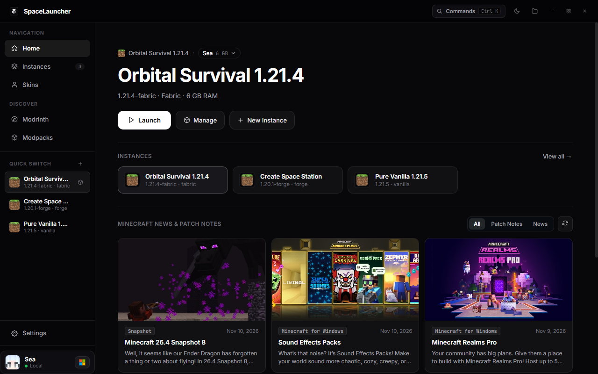
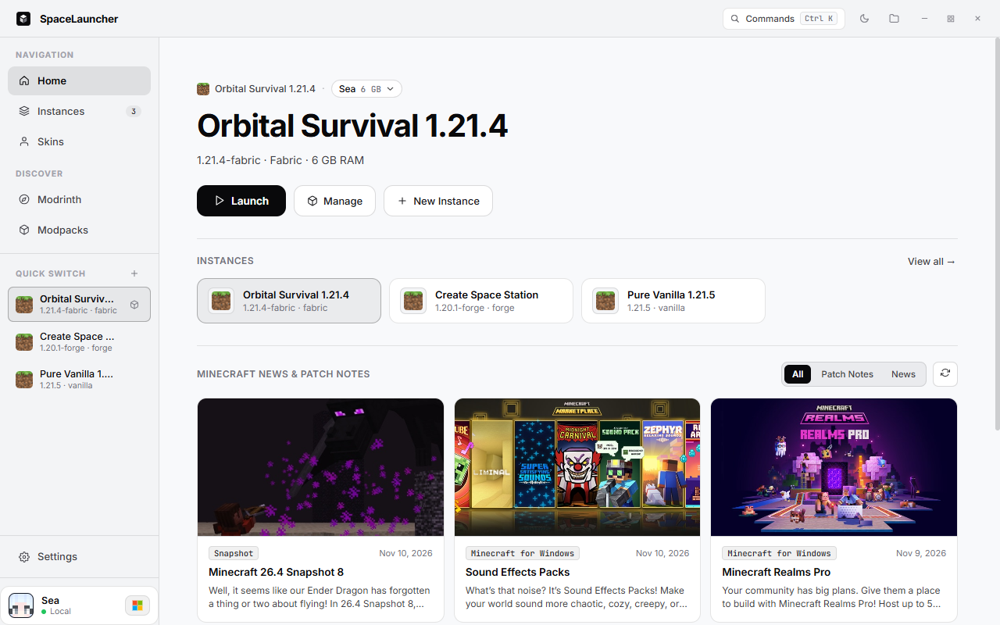
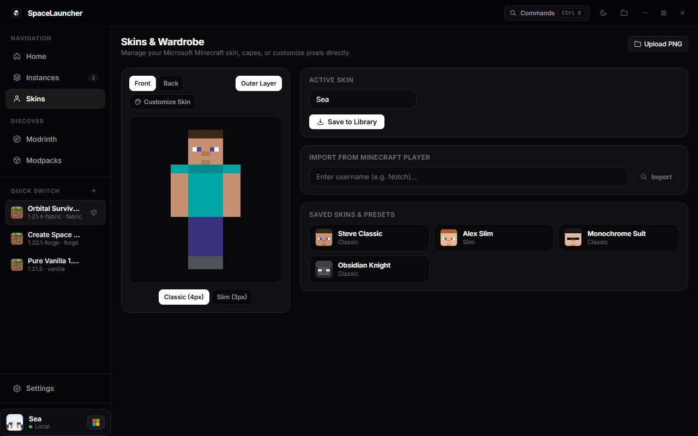
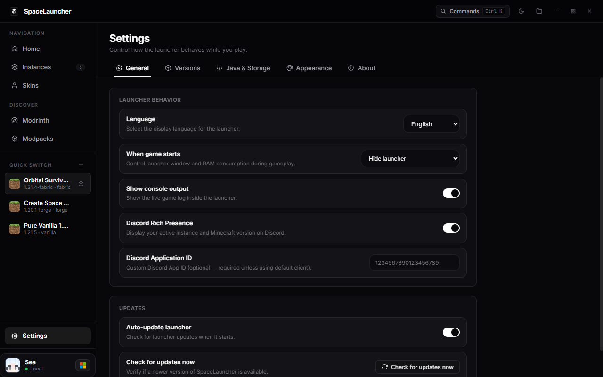

<div align="center">
  
  <h1>SpaceLauncher</h1>
  <p>A clean, fast Minecraft launcher with isolated instances, 3D Skin Studio, and Modrinth support.<br />Forked &amp; maintained by <b>Sea</b>.</p>

  <p>
    <a href="https://github.com/seaze-code/SPACELauncher/releases/latest"></a>
    <a href="LICENSE"></a>
    
  </p>

  <p>
    <a href="https://github.com/seaze-code/SPACELauncher/releases/latest/download/SpaceLauncher-WebSetup.exe"><b>Download for Windows (Web Setup · 122 KB)</b></a>
    &nbsp;&middot;&nbsp;
    <a href="https://github.com/seaze-code/SPACELauncher/releases/latest">All Downloads</a>
  </p>
</div>

---

## Screenshots

<table>
  <tr>
    <td align="center" width="50%">
      
      <br /><sub><b>Home — Dark</b></sub>
    </td>
    <td align="center" width="50%">
      
      <br /><sub><b>Home — Light</b></sub>
    </td>
  </tr>
  <tr>
    <td align="center" width="50%">
      
      <br /><sub><b>3D Skin Studio</b></sub>
    </td>
    <td align="center" width="50%">
      
      <br /><sub><b>Settings</b></sub>
    </td>
  </tr>
</table>

---

## Downloads

Grab the latest build from [Releases](https://github.com/seaze-code/SPACELauncher/releases/latest):

| Platform | Recommended | Portable / Other |
| :--- | :--- | :--- |
| **Windows (x64)** | [`SpaceLauncher-WebSetup.exe`](https://github.com/seaze-code/SPACELauncher/releases/latest/download/SpaceLauncher-WebSetup.exe) *(122 KB web installer)* | [`SpaceLauncher.exe`](https://github.com/seaze-code/SPACELauncher/releases/latest/download/SpaceLauncher.exe) · [`SpaceLauncher-Portable-Windows.exe`](https://github.com/seaze-code/SPACELauncher/releases/latest/download/SpaceLauncher-Portable-Windows.exe) |
| **macOS (ARM64)** | [`SpaceLauncher-mac-arm64.dmg`](https://github.com/seaze-code/SPACELauncher/releases/latest/download/SpaceLauncher-mac-arm64.dmg) | [`SpaceLauncher-mac-arm64.zip`](https://github.com/seaze-code/SPACELauncher/releases/latest/download/SpaceLauncher-mac-arm64.zip) |
| **Linux (x64)** | [`SpaceLauncher.AppImage`](https://github.com/seaze-code/SPACELauncher/releases/latest/download/SpaceLauncher.AppImage) | [`SpaceLauncher.deb`](https://github.com/seaze-code/SPACELauncher/releases/latest/download/SpaceLauncher.deb) · [`SpaceLauncher.tar.gz`](https://github.com/seaze-code/SPACELauncher/releases/latest/download/SpaceLauncher.tar.gz) |

> Using Windows? `SpaceLauncher-WebSetup.exe` is only ~122 KB and fetches the latest release archive into `%LOCALAPPDATA%\SpaceLauncher`. If you want an offline installer, grab `SpaceLauncher.exe` instead.

---

## What it does

- Launch directly from the Home screen with quick instance switching, Quick Join server IP, and Minecraft news.
- Keep each modpack or version in its own isolated folder (Vanilla, Fabric, Forge, NeoForge, Quilt, and Snapshots).
- Manage saved Worlds (`.zip` backup & restore tools), inspect game Screenshots in a gallery, and export/share instances as `.mrpack` or `.zip`.
- Auto-install compatible Adoptium Java runtimes (`8`, `17`, `21`) on launch or with one click in settings.
- Preview, paint, and upload skins in the built-in 3D Skin Studio with Classic/Slim toggles and cape switching.
- Install `.mrpack` / `.zip` archives, local `.jar` mods, shaders, resource packs, and datapacks, or browse Modrinth.
- View per-instance logs in a dedicated console tab, show active instances with Discord Rich Presence, and update fast with lightweight Delta (`app.asar`) patches.
- Match Windows light/dark mode automatically (`System`), or switch between White (`Light`), Black (`Dark`), and color themes.
- Open anything fast with `Ctrl+K`, and switch UI languages (`English`, `ไทย`, `Español`, `Français`).

---

## Building from source

Requires **Node.js 22+**, **npm**, and **Java 17+** (for running Minecraft).

```bash
git clone https://github.com/seaze-code/SPACELauncher.git
cd SPACELauncher
npm install
npm run build
```

Package an unpacked Windows build:

```bash
npm run build:win:dir
```

NSIS scripts live in `script/compile-web-installer.nsi` and `script/compile-electron.nsi`.

---

## Credits

- Forked from [OpenLauncher](https://github.com/CesarGarza55/OpenLauncher) and maintained by **Sea**
- Licensed under the [GPL-2.0 License](LICENSE)
- Not affiliated with Mojang AB or Microsoft
